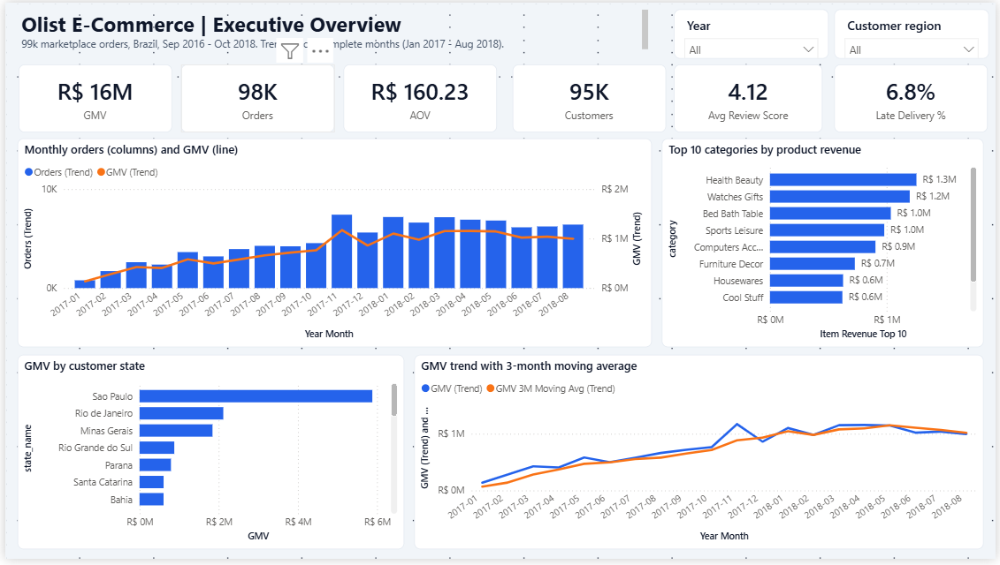
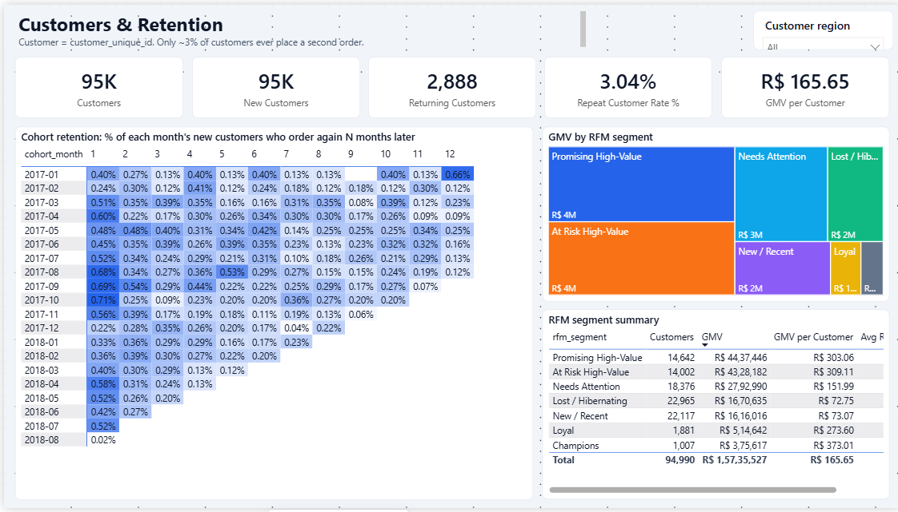
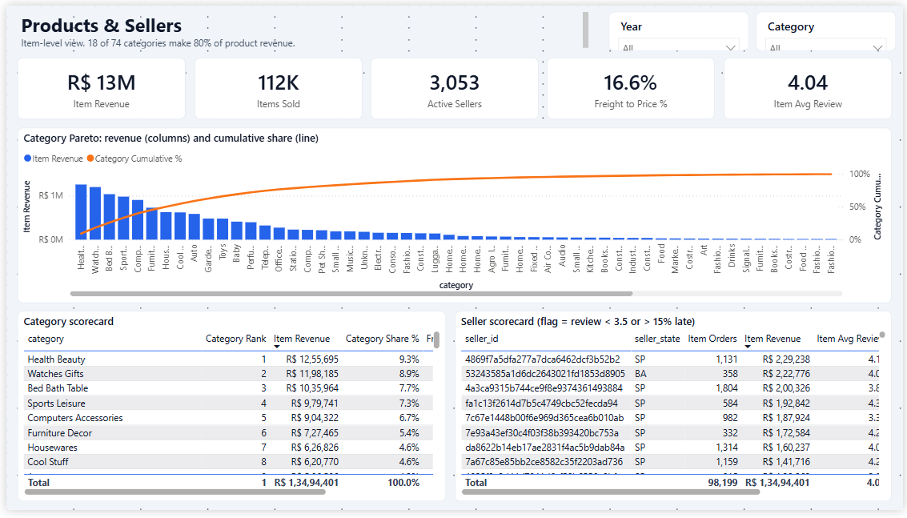
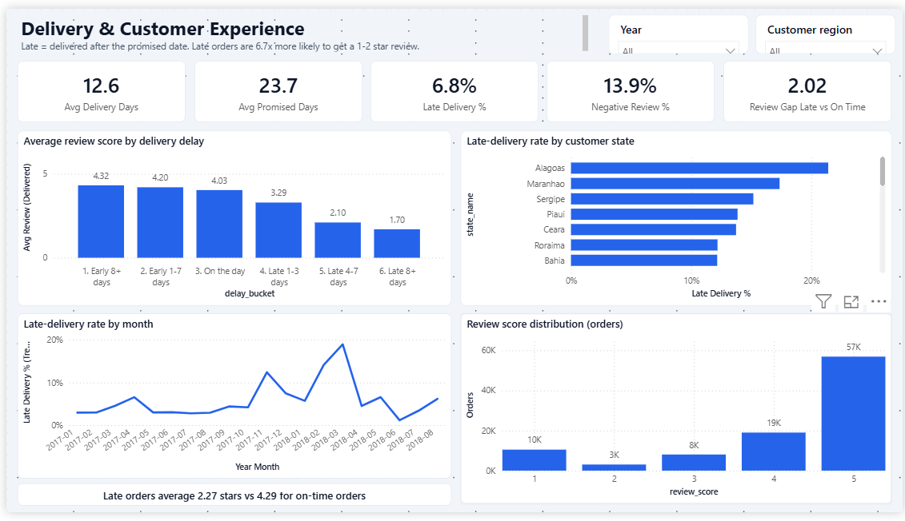

# Olist E-Commerce Performance & Customer Analytics

**An end-to-end analysis of ~100k real marketplace orders, from raw CSVs through SQL, Python
and statistics to a Power BI dashboard, ending in business recommendations.**

`SQL (MySQL 8 / SQLite)` · `Python (pandas, NumPy, SciPy, Matplotlib)` · `Power BI (DAX, star schema)` · `Statistics (hypothesis testing)`

---

## Business problem
Olist is a Brazilian marketplace that connects small sellers to large online stores.
Leadership wants to know:
1. **Sales:** how fast are we growing, and which categories and regions drive GMV?
2. **Customers:** do customers come back? Which customers are worth retaining?
3. **Operations:** do we keep our delivery promise, and how does that affect reviews?
4. **Sellers:** which sellers drive revenue, and which ones damage the customer experience?

## Key findings
*99,441 orders · 94,990 customers · R$ 15.74M GMV · Sep 2016 - Oct 2018.
Full details in [`outputs/INSIGHTS_REPORT.md`](outputs/INSIGHTS_REPORT.md); every number is generated by the pipeline.*

| # | Finding | Evidence |
|---|---|---|
| 1 | **Growth depends entirely on new customers.** Only **3.0%** of customers ever order twice, and on average **0.46%** of a month's new customers return the next month. | `sql/05` repeat & cohort queries, cohort heat-map |
| 2 | **Late deliveries wreck reviews.** **6.8%** of orders arrive late. Late orders average **2.27 stars vs 4.29** on time, and are **6.7x** more likely to get a 1-2 star review. | Mann-Whitney U and chi-square, p < 0.001; 95% CI of the drop 1.98-2.06 stars |
| 3 | **Delivery problems are regional.** Alagoas has **21.4%** late deliveries vs **4.0%** in Parana. Promised dates average 23.7 days against an actual 12.6. | `sql/07` delivery_by_state |
| 4 | **Strong growth.** Jan-Aug 2018 GMV was **+140%** vs Jan-Aug 2017. The peak month was Nov 2017 (Black Friday, 7,423 orders). | `sql/04` yoy_jan_aug |
| 5 | **Revenue is concentrated.** 18 of 74 categories make 80% of revenue. Sao Paulo state is **37.4%** of GMV. | Pareto in `sql/06` |
| 6 | **High-value customers are drifting away.** The "At Risk High-Value" RFM segment is **14.7%** of customers but **27.5%** of GMV. | RFM in `sql/05` and `s04` |

**Recommendations:** (1) a second-purchase programme for first-time buyers; (2) state-specific delivery
promises and carrier SLAs, starting with the North-East states; (3) a seller quality scorecard; (4) a win-back
campaign for "At Risk High-Value" customers; (5) free-shipping thresholds in high-freight categories
(freight adds 29.7% to price in Food & Drink).

## Dashboard
A 4-page Power BI report: `powerbi/Olist_Ecommerce_Dashboard.pbip` (Power BI Project, text-based and Git-friendly).
It has 10 tables in a star schema, 8 relationships and 50 DAX measures, and is generated by `powerbi/build_pbip.py`.

| Executive Overview | Customers & Retention |
|---|---|
|  |  |
| **Products & Sellers** | **Delivery & CX** |
|  |  |

## Pipeline
```
data/raw (9 Kaggle CSVs)
   │  s01_clean_transform.py   audit · clean · business rules · star schema
   ▼
data/processed (fact + dim CSVs)
   ├─► s02_build_database.py   load to SQL · run 30+ analysis queries (sql/03-08)
   ├─► s03_eda_sales.py        trends · categories · geography · delivery · payments (10 charts)
   ├─► s04_customer_analytics  repeat rate · cohort retention · RFM segmentation
   ├─► s05_statistical_tests   Mann-Whitney U · chi-square · Spearman · bootstrap CI
   │
   ├─► outputs/INSIGHTS_REPORT.md (auto-generated)
   └─► Power BI: 4-page dashboard, 40+ DAX measures
```

## Repository structure
```
├── data/raw/                 Kaggle CSVs (not committed; see PUT_OLIST_CSVS_HERE.md)
├── data/processed/           clean star-schema tables (generated)
├── sql/
│   ├── 01_schema_mysql.sql   MySQL star schema with keys and foreign keys
│   ├── 02_load_mysql.sql     LOAD DATA with NULL handling
│   ├── 03_data_quality_checks.sql
│   ├── 04_sales_kpis.sql     GMV, AOV, MoM (LAG), moving average, YoY, state ranking
│   ├── 05_customer_analysis.sql  repeat rate, cohort retention, RFM (NTILE)
│   ├── 06_product_seller_analysis.sql  Pareto, growth, freight ratio, seller deciles
│   ├── 07_delivery_and_reviews.sql  late rate, delay buckets vs review score
│   └── 08_payments.sql
├── python/                   pipeline steps s01-s05 + run_all.py
├── powerbi/                  build guide, measures.dax, theme, .pbix, screenshots
├── outputs/                  figures, SQL results, statistical tests, insights report
└── docs/DATA_DICTIONARY.md   definitions of every metric and column
```

## How to run
```bash
pip install -r requirements.txt
# 1. download the dataset into data/raw/ (see data/raw/PUT_OLIST_CSVS_HERE.md)
python python/run_all.py
# 2. (optional) load into MySQL: run sql/01_schema_mysql.sql, then sql/02_load_mysql.sql
python powerbi/build_pbip.py   # 3. generate the Power BI project
# 4. open powerbi/Olist_Ecommerce_Dashboard.pbip in Power BI Desktop and click Refresh
```

## Design decisions
- **Customer = `customer_unique_id`.** Olist issues a new `customer_id` for every order, so counting
  it would hide all repeat behaviour.
- **Trends use Jan 2017 - Aug 2018 only.** The first and last months of the data are incomplete.
- **Portable SQL.** Date fields are computed once in Python, so the same SQL runs on MySQL and
  SQLite, and every query is checked automatically on each run.
- **Two fact tables** (orders and items) sharing conformed dimensions. This avoids double-counting
  order values on product and seller views.
- **Non-parametric tests**, because review scores are ordinal and skewed.

## Limitations and next steps
- The findings are observational: late delivery is associated with bad reviews, but that isn't
  proof of cause. Next step: an A/B test of more conservative delivery promises in the worst states.
- Review text (Portuguese) is not analysed yet. Sentiment analysis would explain *why* reviews are negative.
- Data covers 2016-2018 for one marketplace.

---
*Data: [Brazilian E-Commerce Public Dataset by Olist](https://www.kaggle.com/datasets/olistbr/brazilian-ecommerce), CC BY-NC-SA 4.0.*
